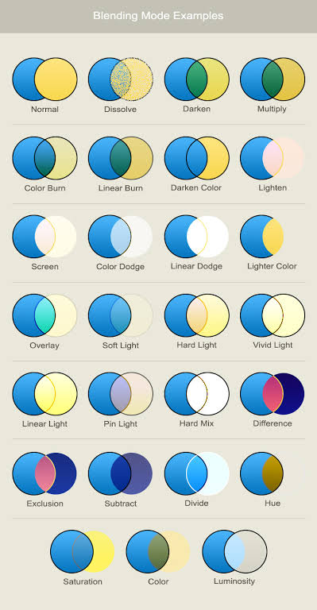

# Приоритеты

1. Ежедневная работа: сохранение настроек кисти и свои пресеты, жесты и радиальное меню, заливка, трансформация, alpha lock и clipping mask.
2. Пипетка с превью, Color Wheel в OKLCH с gamut mask, сглаживание как в Paint Tool SAI.
3. Фреймы на холсте и фильтрация слоёв.
4. Референсы.
5. Запись сессии → таймлапс → трансляция.
6. Векторные слои, слои с назначением, потом решить, нужны ли линейки на растре.
7. Градиент, PSD.

Параллельно: инфраструктура i18n и встроенные превью, по мере появления UI.

Сквозное требование: каждая новая фича делается отдельным модулем (см. «Модульность»).

# Модульность

Очень важно. Из фич-модулей должно быть можно собирать разные программы для рисования под разные задачи и разных пользователей, как в PDF Panorama. Каждый модуль поддерживается и развивается отдельно.

Сейчас модульна только часть: storage, renderer, обработчики штрихов и движки кистей подключаются JSX-провайдерами в рецепте (`StudioApplication.tsx`). Слои, выделение, симметрия, пипетка и вставка картинок встроены в `paintRuntime.ts` и в закрытый union команд `protocol.ts`. Новая фича (заливка, трансформация, референсы) сейчас требует правки протокола, runtime и `PaintStudio.tsx`.

Что нужно:

- Фича — пара половин: часть для рецепта движка (worker или main thread) и UI-часть для студии. Обе подключаются JSX в своей сборке; программа без модуля просто его не подключает.
- Расширяемые команды и события вместо закрытого union: модуль регистрирует свои команды под своим именем. `brush-command` с `command: unknown` — уже прообраз такого механизма.
- Документ и файл `.paint` должны поддерживать данные модулей: типы слоёв (вектор, анимация), фреймы, референсы. Сборка без модуля открывает такой файл, сохраняет чужие данные без изменений и показывает заглушку.
- Undo/redo, автосохранение, экспорт и LOD — общие сервисы, которые модули используют, а не реализуют заново.
- Начать с вынесения уже встроенной фичи (например, симметрии или выделения) — на ней проверить границы, потом делать новые фичи сразу модулями.
  - Сделано для симметрии: `defineDocumentFeature` + `<DocumentFeatures>` в рецепте, общая команда `{ type: 'feature' }`, данные модулей в документе (`features`), чужие данные сохраняются без изменений. UI-половина пока подключается в `PaintStudio.tsx` вручную; расширяемость UI студии и вынесение выделения/слоёв — следующие шаги.
- Проверка: вторая минимальная сборка (например, скетчбук без ABR и слоёв) в тестах, чтобы зависимости между модулями не прорастали незаметно.
  - Сделано (2026-10-10): `features/session` — сессия рисунка без раскладки (`createPaintSession`, `PaintStage`, общие оверлеи и уведомления). Из неё собраны варианты UI (`src/variants`): Classic (прежний редактор), Procreate (опорная копия), Puck (стекло из Puck-галереи) и демо отдельных фич (заливка, симметрия, градиент) на своих документах. Открываются в playground как `/paint/<id>` и на dev-сервере Paint как `/variants.html#<id>`. Осталось: сессия пока создаёт все контроллеры сразу — модули, которых вариант не показывает, стоит подключать по требованию.
- Будущая отдельная сборка: приложение для разминки, а не режим Paint. Таймер жестового рисования показывает референс позы на 30 или 60 секунд, потом следующий; наброски сохраняются в папку. Из Paint берёт холст, кисти и хранение, своё — источник референсов, таймер и сетку набросков.

# Кисти

## Настройки и пресеты

Сейчас параметры кисти сбрасываются при перезагрузке. Нужно сохранять текущие настройки и давать сохранять свои пресеты.

Решено делать через переработку кистей: кисть = пресет из библиотеки, ластик — режим, минимальная ежедневная панель. Подробности — в [TODO-brushes.md](TODO-brushes.md).

## Автокалибровка нажима

Пользователь рисует несколько штрихов в окне калибровки, приложение строит кривую нажима (minimum, maximum, firmness) по распределению его нажима. Новое перо, другая рука или другой планшет перестают требовать ручной настройки. Калибровка хранится для устройства, а не в пресете кисти.

Сделано (2026-10-10): Drawing menu → Calibrate pen pressure…, три шага штрихов на тестовом холсте `BrushPreview`, одна кривая устройства в `localStorage`, применяется в `attachInput` до всех процессоров и движков. Пока перо откалибровано, кривая кисти по умолчанию (леонардовские 5%/80%) работает как 0%/100% (решение пользователя). Потом (по отзыву после проверки на планшете): точки кривой тянутся прямо на графике, тестовый холст рисует текущей кистью и перерисовывает свои штрихи при каждом изменении, калибровка вынесена в пакет `@app-game/pressure-calibration` и открывается отдельно на `/pressure.html`. Окно в Paint не модальное, превью следует за настройками кисти и перерисовывается без мерцания. 2026-10-16, после проверки на планшете: кривая — свободные точки как в CLIP STUDIO (добавить тапом по кривой, тащить по x и y, удалить двойным тапом или уводом за край), монотонный сплайн Стеффена без излома, автокалибровка ставит около пяти точек, живой маркер нажима. 2026-10-17: калибровка — сессионное окно в каждом варианте (окно Pen → Calibrate…, в Classic ещё Drawing menu, в Desktop меню, в Command команда «calibrate pen pressure»), кривая применяется в `createPaintSession`, предсказанные точки идут через ту же кривую. Причины решений — в JSDoc пакета `@app-game/pressure-calibration` и `pressureCurve.ts`. Осталось:
- проверить на MovinkPad свободные точки, маркер и автокалибровку из пяти точек;
- предложить калибровку при первом рисовании пером на новом устройстве.

## Сглаживание

Взять за образец стабилизатор Paint Tool SAI — лучшее сглаживание из всех программ, что я пробовал. У нас уже есть Studio и Leonardo normal/smooth, надо сравнить ощущения с SAI и подобрать алгоритм.

Сделано (2026-10-05): стабилизатор заменён точным портом SAI 2 по разбору его кода (`paint-tool-sai-analysis`): уровни 0–15 и S-1…S-7, скользящее среднее по сэмплам пера и обратная связь S-уровней, нажим с нуля на входе, сужение на отрыве, дуги S-уровней, коррекция неровных пакетов, кривые Безье. Не перенесён режим Ver.1. Осталось: сравнить ощущения с SAI на планшете; уровни считаются в сэмплах пера, поэтому на планшете с высокой частотой они слабее, чем в SAI на Windows — если так, пересэмплировать ввод.

Rope-режим из Lazy Nezumi не нужен.

## Инструменты для рисования

Нужны также инструменты для рисования.

- **Liquify.** Кисть, которая толкает пиксели (push, twirl, pinch, bloat), чтобы поправить анатомию или лицо без перерисовки. Сетка Warp из трансформации этого не заменяет.
- **Кисть из холста.** Выделил кусок холста — он становится кончиком новой кисти в библиотеке, как Define Brush Preset в Photoshop.
- **Клонирующий штамп и лечащая кисть.** Источник — точка холста (Alt + нажатие), рисование переносит пиксели с неё; лечащая кисть дополнительно подгоняет тон и цвет под окружение.
- **Перерисовка штриха.** Последние несколько штрихов остаются «живыми»: им можно задним числом сменить пресет, размер или цвет, и они перерисуются из сохранённого ввода пера. После выхода из окна живых штрихов они становятся обычными пикселями.
- **Кисть истории** (позже). Как History Brush в Photoshop: под кистью проступает состояние документа из выбранного шага истории. Основа уже есть: ABR-ластик умеет Erase to History, источник выбирается в `HistorySourceControl`. Нужно то же восстановление для любой кисти и отдельный инструмент, а не только режим ластика.

## QuickShape

Сделано (2026-10-10): модуль `features/quickshape`, подгонка `paint-core/src/shapeFit.ts`, общие возможности движка `replace-stroke` и `strokeHold` в `attachInput`. С 2026-10-17 работает во всех вариантах через сессию, переключатель и задержка есть в каждом. Осталось:

- проверить на MovinkPad пером: задержку, пороги распознавания, нажим вдоль фигуры (и с кривой калибровки нажима), ABR-кисти (Build-up, scatter), цену перерисовки на каждое движение на Adreno; при необходимости показывать превью хвостом и перерисовывать один раз на отпускании;
- привязку вторым пальцем при palm rejection: касание со стороны руки с пером игнорируется, так что привязывает только палец свободной руки — проверить, удобно ли;
- проверить в Chrome на планшете с включёнными предсказанием и Ink-следом, что прозрачный стиль (`withheld` в `createInkTrail`) действительно прячет след, пока перо правит фигуру;
- тесты на записанных штрихах-фигурах с планшета (сейчас записанные штрихи — только дуги, эллипс и кривая из старых записей);
- потом: чип «Изменить фигуру» после отпускания, как в Procreate (эллипс ↔ круг ↔ ломаная); первый Undo после QuickShape возвращает штрих от руки; произвольные кривые (сплайн по штриху).

## Заливка

Bucket: допуск, расширение границы, источник «все слои / текущий слой / референс-слой». Позже — закрытие щелей в лайн-арте.

Сделано модулем `features/fill` (движок — `fillEdit` на `defineDocumentEdit`, UI — `createFill` и `FillPanel`): инструмент Fill (G), допуск, расширение, непрозрачность, источник «все слои / активный слой», заливка в пределах видимой области (не больше 4096 px вокруг точки; если залитое упирается в этот предел — отказ с просьбой приблизить). Ограничение выделением сделано: с лассо заливка не выходит за выделение. Закрытие щелей сделано (Close gaps, до 32 px), сглаживание края тоже (Smooth edges). Осталось: референс-слой как источник, заливка в новый слой под лайн-артом.

## Градиент

Линейный и радиальный, с учётом Smooth color.

Сделано модулем `features/gradient` (движок — `gradientEdit`, UI — `createGradient`, `GradientPanel`, `GradientPreview`): инструмент Gradient, протяжка с превью, линейный/радиальный, основной → фоновый (или наоборот) или → прозрачный, непрозрачность, Smooth color/Classic, дизеринг, внутри лассо или по видимой области (до 4096 px), alpha lock, один шаг undo. Редактор цветовых точек сделан (до 16 точек, цвет основной/фоновый/свой, непрозрачность, пресеты, разворот). Повторение/отражение, угловой и ромбовидный сделаны. Осталось: градиент в маску.

# Color Picker

Сделано (`features/color`, выборка — `colorSample.ts` в paint-core):

- ~~превью: кольцо, где верхняя половина — цвет под курсором, нижняя — текущий цвет~~ — кольцо 120 px вокруг касания, пока оно удерживается; цвет берётся из последнего кадра по мере движения, при отпускании — точно и применяется;
- ~~временная пипетка по удержанию Alt или долгому нажатию пальцем~~ — Alt + нажатие с кистью, удержание пальцем; обе протягиваются до отпускания;
- ~~источник: все слои или только текущий слой~~ — переключатель в панели цвета;
- ~~усреднение по области 3×3 / 5×5~~.

~~Превью при наведении пера с зажатым Alt (без касания)~~ — сделано: кольцо показывается, пока Alt зажат и перо или мышь над холстом.

По отзыву с планшета (2026-10-04): пипетка удержанием пальцем убрана (палец закрывает точку); кнопка пипетки — под кругом цвета, одно нажатие; пока пипетка взведена, кольцо следует за пером при наведении; в кольце — лупа с квадратом замера.

Нужно сделать Color Wheel получше и несколько вариантов, типа Coolorus 2 с цветовым кругом. Главное в Coolorus — gamut mask и гармонии. Строить колесо в перцептивном пространстве (OKLCH), чтобы яркость не скакала при смене оттенка.

Классический круг сделан модулем `features/hue-triangle` (по отзыву с планшета 2026-10-04): кольцо оттенка и треугольник насыщенности и яркости, переключатель Square / Triangle / Wheel.

Первая версия сделана модулем `features/color-wheel`, переключатель Square/Wheel в панели цвета: круг в OKLCH (тон по кругу, насыщенность — доля максимальной хромы sRGB при этой светлоте, светлота — ползунок), гармонии (дополнительная, аналоговая, триада, расщеплённая, квадрат) точками на круге, gamut mask по Гёрни (триада, расщеплённая, дополнительная, квадрат, атмосферная) с поворотом за ручку; цвет вне маски притягивается к её границе. Свои формы маски сделаны: вершины маски перетаскиваются, и она становится Custom; точка в середине ребра добавляет вершину (до 16), двойной тап по вершине удаляет её (не меньше 3). Осталось: несколько масок, треугольник/квадрат светлоты-насыщенности внутри круга как в Coolorus, палитра гармонии в один тап.

# Цвет и тон

- **Пигментное смешивание.** Синий с жёлтым дают зелёный, а не серый, как в настоящих красках. Модель Кубелки–Мунка: библиотека spectral.js (MIT) раскладывает цвет на спектральные коэффициенты, смешивает их и собирает обратно в RGB; Mixbox не подходит из-за лицензии CC BY-NC. Делать третьим вариантом общей настройки рисунка рядом со Smooth color: Classic / Smooth / Pigment. Pigment меняет то, где краски смешиваются как Normal: штампы кисти поверх краски в слое, Smudge и Mixer, заливку и градиент, сведение слоёв в Normal. Остальные режимы наложения (Multiply, Screen и т. д.) остаются в линейном свете, как в Smooth. Портировать в WGSL; проверить стоимость на Adreno, где композитинг уже дорогой, и совпадение с CPU-портом `mergeTilePixels`.
- **Палитра документа.** Использованные в рисунке цвета собираются и группируются в OKLCH и показываются палитрой. Любой цвет палитры можно перекрасить во всём слое сразу.
- **Проверка тонов.** По удержанию кнопки или клавиши холст показывается в оттенках серого по светлоте OKLCH, чтобы проверить тональные отношения. Рядом — режим «прищуриться»: холст размывается, видны только крупные пятна. Только отображение, рисунок не меняется.

# Трансформация

Масштаб, поворот, отражение, искажение выделения или слоя. Сейчас lasso только перемещает.

Первая версия сделана модулем `features/transform` (движок — `transformEdit`, UI — `createTransform`, `TransformOverlay`, `TransformActions`): кнопка Transform на тулбаре или ⌘/Ctrl+T трансформирует выделение, а без него — весь активный слой. Рамка по границам содержимого: перетаскивание внутри — сдвиг, угловые ручки — пропорциональный масштаб от противоположного угла (Shift — свободный), боковые — по одной оси, круглая ручка — поворот (Shift — шаг 15°); Flip, поворот на 90°, Reset, Cancel (Esc, Undo), Done (Enter, смена инструмента). Во время правки выделенные пиксели «плавают»: рендерер каждый кадр вырезает их из слоя и рисует по матрице рамки на GPU (`FloatingPixels` в paint-core, `context.floating` у правок документа), документ не меняется до Done; Done один раз пересчитывает результат билинейно (или nearest для пиксель-арта), вся трансформация — один шаг undo. Пока двигаешь рамку, она и панель скрыты. Искажение/перспектива сделаны: кнопка Distort, углы двигаются независимо, пиксели следуют в перспективе (гомография на GPU-превью и при пересчёте). Бикубическая интерполяция при Done сделана. Числовой ввод (размер, угол, сдвиг) сделан. Точка опоры сделана (перетаскиваемый маркер). Warp сделан: кнопка Warp, сетка 4×4 точек бикубического патча Безье как в Photoshop (угол тянет соседние точки края), превью сеткой 32×32 на GPU, при Done — сетка треугольников на CPU. По отзыву с планшета (2026-10-04): рамка скрывается при любом перетаскивании (кроме точки опоры и сетки warp); Distort без перспективы (кнопка Perspective, билинейно); сетка warp до 4×4 участков; перетаскивание внутри warp изгибает поверхность, как в Photoshop, а снаружи — двигает весь warp. Осталось: пресеты warp (арка, флаг и т. п.), области больше 4096 px, трансформация нескольких слоёв.

# Vector Graphics

Очень важно иметь инструменты для создания чёткого лайн-арта. Инструменты векторной графики могут использоваться для масок, рисования сетки перспективы, заливок, скетчинга и т. д.

Идея: векторный штрих хранит центральную линию с давлением и наклоном и растеризуется той же кистью при любом зуме (как векторные слои в Clip Studio). Нужно:

- редактирование контрольных точек и толщины;
- векторный ластик, который режет штрих до пересечения;
- прямые, эллипсы, перспектива, концентрические линии;
- заливка по контурам векторного слоя.

Линейки и привязки на растровом слое — решить после векторных инструментов, возможно, они не понадобятся.

# Слои

## Кисть внутри выделения

Сделано (2026-10-04): с выделением кисть, ластик и инструменты ретуши рисуют только внутри него — после каждого шага пиксели тайла вне выделения возвращаются (`gpu/strokeClip.ts`), так что обрезаются все движки, включая ABR и Smudge, и превью штриха. С 2026-10-05 — пропорционально покрытию маски, так что на растушёванном крае штрих плавно сходит на нет.

## Инструменты выделения

Сделано (2026-10-04, по отзыву «градиент и заливка бесполезны без выделения»): Fill и Gradient убраны с тулбара и из быстрых действий — это инструменты выделения, кнопки на панели рядом с выделением, без выделения не включаются, а потеря выделения возвращает к лассо. Добавлены прямоугольное и эллиптическое выделение (кнопки формы на той же панели и в подсказке без выделения) и Fill selection — залить всё выделение цветом. Сделано (2026-10-05): выделение — маска покрытия в движке (`paint-core/src/selectionMask.ts`: разреженные тайлы 0–255 и покрытие за их пределами, так что инверсия и Select All тянутся по всему бесконечному холсту), инструменты — модуль `features/selection` (правка движка `selectionEdit`). Волшебная палочка (W: допуск, Contiguous, все слои, сглаженный край), полигональное лассо, режимы New/Add/Subtract/Intersect (кнопки или Shift/Alt/оба при нажатии), Invert (⌘⇧I), Select All (⌘A), Feather (радиус в px). Копирование, вырезание, удаление, трансформация, заливка и градиент учитывают мягкий край; трансформация переносит выделение вместе с пикселями. Осталось: Grow/Shrink, выделение по цвету с выбором диапазона, сохранение выделения в файле и в истории undo, маска выделения как маска слоя, быстрая маска (рисование выделения кистью).

## Smooth color для всех слоёв

Сделано (по отзыву 2026-10-04: «почему Smooth color — режим наложения, если это должно быть поведением по умолчанию для всех типов смешивания?»): Smooth color больше не режим наложения, а настройка всего рисунка (флажок «Smooth color for all layers» в панели слоёв, по умолчанию включён, сохраняется с рисунком вне истории undo). Все режимы — Normal, Multiply, Screen, Overlay — смешиваются в линейном свете, как «Blend RGB colors using gamma 1.0» в Photoshop. Старые рисунки: слои Smooth color становятся Normal в линейном рисунке. PSD открывается в классическом смешивании.

## Alpha lock и clipping mask

Базовые вещи для покраски. Маски слоя — позже.

Alpha lock сделан: свойство слоя `alphaLock` (замок в панели слоёв), штрихи round/textured/ABR и заливка перекрашивают только непрозрачные пиксели, сохраняя их альфу; ластик на таком слое ничего не делает. Clipping mask сделан: свойство слоя `clipping` (кнопка «Clip to layer below»), обрезанный слой виден только там, где есть пиксели его базы — ближайшего необрезанного слоя снизу (альфа умножается на собственную альфу базы, без её прозрачности); скрытая база скрывает группу. Учитывается на экране, в Merge Down и в заливке по всем слоям; пока не учитывается в выборке Smudge/Mixer по всем слоям.

## Слои с назначением

Слои или группы слоёв должны иметь своё назначение:

- слой для скетчей — только инструменты для скетчей; не попадает в экспорт, по умолчанию полупрозрачный;
- слой для покраски — кисти для покраски и расширенный Color Wheel;
- векторный слой — без растровых инструментов;
- слой для анимации — timeline;
- и т. д.

Так UI не будет перегружен: пользователю доступны только те инструменты, которые ему сейчас нужны. Не превращать приложение в Photoshop, где панели занимают больше места, чем холст.

Идея: если взять инструмент другого типа (например, векторное перо на растровом слое), создавать или выбирать слой нужного типа, а не блокировать инструмент.

## Слои на бесконечном холсте

Много рисунков на одном холсте будут требовать много слоёв, и окно со слоями превратится в бесконечный список.

- ~~Скрывать в панели слои, тайлов которых нет на экране, кроме выбранного. Не перестраивать список во время движения камеры, только после остановки. Показывать, сколько слоёв скрыто. Новые пустые слои не скрывать.~~ — сделано: `createLayerFilter` в `features/layers`, движок сообщает слои в кадре (`layersInView` в paint-core), список обновляется через 300 мс после остановки камеры, кнопка под списком показывает скрытые.
- Фреймы (artboards): именованный прямоугольник на холсте. Заменяет региональные и проектные группы: панель слоёв показывает слои активного фрейма, PNG экспортирует фрейм, ссылкой можно поделиться на фрейм, к фрейму можно перейти.
  - Первая версия сделана модулем `features/frames` (данные документа `framesFeature`, блок вверху панели слоёв, контуры на холсте): новый фрейм по текущему виду, выбор активного фрейма с переходом к нему, переименование, удаление, PNG фрейма в 100% (до ~8 Мп), ссылка `#frame=<id>` — пока только на этом устройстве, общих ссылок нет. Прямоугольник фрейма меняется ручками на холсте (кнопка Adjust). Фрейм из выделения сделан: New frame с лассо берёт его границы. Осталось: экспорт в другом масштабе, ссылки для других людей (нужна сеть), изменение фреймов как шаг undo.
- Фильтры слоёв.
- Может быть: при отдалении показывать слои в регионах, чтобы их можно было переносить между регионами.

# Референсы

Картинка, которая не является слоем и не растрируется в тайлы, что-то вроде smart object из Photoshop:

- два режима: закреплена на экране или закреплена на холсте;
- хранит оригинал, разрешение холста не влияет на её разрешение;
- тайлы, level of detail, виртуальные страницы и вытеснение, как у основного холста, чтобы много больших референсов не съедали RAM и GPU-память;
- прозрачность, отражение, ч/б.

# Жесты и быстрый доступ

На планшете клавиатуры нет:

- ~~тап двумя пальцами — undo, тремя — redo, удержание пальцем — пипетка~~ — сделано (пипетку удержанием потом убрали, см. Color Picker) (`touchGestures` в `attachInput`: тап короче 350 мс без сдвига больше 10 px, удержание 500 мс; камера после тапа возвращается к исходной);
- ~~радиальное меню под перо~~ — сделано модулем `features/radial-menu`, вместе с навигационной шайбой: боковая кнопка пера (правый клик), Space или V открывают уменьшенную шайбу (120 px) с кольцом действий — кисть, ластик, заливка, лассо, трансформация, undo/redo, пипетка и три недавних пресета. Нажатие на действие или жест «нажал кнопку пера → повёл к действию → отпустил». Дальше: настраиваемые слоты, свои действия модулей.

# Отзывчивость

Сделано (2026-10-10), в master с 2026-10-16. Переключатели — Developer → Pen latency, запоминаются на устройстве:

- Предсказание пера (по умолчанию выключено): `attachInput` отправляет точки `getPredictedEvents` вместе с сэмплами (с сырыми событиями пера — отдельно, с pointermove), движок показывает их в одноразовом хвосте штриха (`withPrediction`) и никогда не рисует в документ. Работает для None, Studio, Normal/Smooth и ABR без сглаживания; стабилизатор и сглаженные ABR отстают от пера намеренно, им предсказание не дают. На MovinkPad Chrome даёт одну точку примерно на 14 мс вперёд. Проверка пером на MovinkPad (2026-10-16): на резких остановках линия перебегает.
- Ink-след браузера (`features/ink-trail`, по умолчанию выключен): между кадрами движка компоситор Chrome дорисовывает штрих до пера круглой линией цвета, прозрачности и размера кисти; для ластиков выключен. На MovinkPad разницы не видно.
- Разогрев GPU (`features/gpu-warmup`, команда `warm`, по умолчанию включён): пока перо висит над холстом, движок перерисовывает вид целиком примерно раз в кадр, до 400 мс после последнего движения. На MovinkPad первые кадры штриха после наведения стоили 7–10 мс вместо 12–14 мс; пером первый штрих заметно быстрее.
- Подгрузка тайлов по ходу камеры (`createCameraMotion` в виртуальной текстуре, всегда включена, переключателя нет): при панорамировании и масштабировании страницы вида через 250 мс запрашиваются после видимых, до 8 за кадр. На MovinkPad при панорамировании 1200 px/s кадров с размытыми тайлами стало 0 из 1553 вместо 87 из 1473. Инерции камеры после флика пока нет.

Осталось: проверить предсказание и ink-след на слабых устройствах; если предсказание оставлять, гасить его на резких остановках (короче горизонт, когда перо тормозит).

При вливании веток, которые ещё не в master:

- **QuickShape** (`feat/paint-quickshape`): не слать предсказание, пока перо удерживает фигуру (`strokeHold`), иначе хвост убегает от фигуры; при замене штриха фигурой стирать предсказание и ink-след (пустой `predicted` в движок, у ink-следа — новый старт или выключение presenter).
- **Калибровка нажима** (`feat/paint-pressure-calibration`): в master настоящие и предсказанные точки собирает один `sample()` в `collect`; при слиянии нажим в нём должен идти через `pressureOf`, тогда и предсказанные точки пойдут по кривой устройства. Ink-след берёт нажим из события сам (`calibrated` в `createInkTrail`) — пропустить его через ту же кривую.

# Сеть и совместная работа

Как минимум надо сделать так, чтобы свой текущий холст можно было отдать одноразовой или постоянной ссылкой, чтобы другие могли смотреть, как художник рисует в реальном времени. Передавать позицию пера (с наклоном, нажимом и hover), мыши, пальцев и камеры, чтобы зрители видели сам процесс.

Начать с записи сессии: лог входных событий плюс периодические снимки тайлов. Из неё получаются таймлапс, трансляция (тот же поток в реальном времени) и воспроизводимые баги и бенчмарки. Зрителю нужно передать ресурсы кистей. Точное повторение на другом GPU не гарантировано, поэтому снимки тайлов — контрольные точки.

Первый шаг сделан: запись ввода для воспроизведения багов модулем `features/recording` (Developer → Record input…, только на dev-сервере): события пера, касаний, мыши и клавиатуры с coalesced-сэмплами, команды документа, изменения состояния редактора, снимок рисунка `.paint` и кадры вида в начале и в конце; `scripts/recording-timeline.mjs` печатает хронологию. Дальше: кольцевой буфер «последняя минута», воспроизведение через Playwright со скриншотами, записи как регрессионные тесты.

- **Разбор на трансляции.** Зритель ставит пометку прямо на холсте, художник видит её поверх рисунка; в документ пометка не попадает. Учителю удобно разбирать работы.
- **Чистый таймлапс.** Из записи сессии вырезаются отменённые штрихи и простои, остаются только финальные штрихи.

# PSD

Импорт и экспорт, отдельным пакетом, как ABR (`abr-parser` / `abr-paint`).

Первая версия сделана: пакет `@app-game/psd` (`readPsd` / `writePsd`, 8-битный RGB, растровые слои, PackBits), мост в paint-core — `psdFile.ts`. Drawing menu → Export layers сохраняет все слои области с рисунком, кнопка PSD у фрейма — слои фрейма; Open drawing открывает `.psd` (холст — в начале координат, вид вписывается). Сохраняются имена (Unicode), видимость, непрозрачность, режимы Normal/Multiply/Screen/Overlay (Smooth color уходит как Normal), clipping, alpha lock; плоское изображение для программ без слоёв. 2026-10-05: кодек заменён на Rust/WASM из `photoshop-analysis/psd-rs` (без потерь, сверен байт в байт на 759 файлах тестов других библиотек, каналы совпадают с psd-tools). Открываются PSB, 16/32 бита, Grayscale, Bitmap, ZIP; читаются все режимы смешивания и Fill (режимов, которых нет в Paint, — как Normal); холст больше 30000 px пишется как PSB. Исследование Photoshop идёт в `photoshop-analysis` (`PSD-FORMAT.md`, `evidence/2026-10-05-psd-*`). Осталось: группы (при импорте раскрываются), маски, точное сведение режимов, эффекты, корректирующие слои, текст, смарт-объекты, преобразование 16/32 бит по эталону Photoshop.

# i18n

Добавить переводы на популярные языки. Основной остаётся английский:

- русский, немецкий, испанский, французский, португальский, сербский (только латиница);
- японский, китайский, корейский;
- арабский, иврит (для проверки RTL);
- хинди, бенгальский — под вопросом.

Нужны ICU-плюрализация и логические CSS-свойства для RTL. Инфраструктуру строк завести сейчас, пока панелей мало.

Но в основном надо полагаться на инфографику — иконки, превьюшки и т. д.

# UI/UX

Для различных инструментов надо показывать, как они работают. Например, dropdown режима смешивания должен показывать на простых примерах (может быть, на кружочках), как будут выглядеть Normal, Dissolve, Darken, Multiply.

Превью рендерить тем же GPU-шейдером, что и холст, а не картинками, чтобы они совпадали с реальным результатом, включая Smooth color.

Сделано для режимов наложения слоя: выпадающий список рядом с непрозрачностью, как в Photoshop (по отзыву с планшета 2026-10-04 кнопки в панели заменены на dropdown), с превью двух перекрывающихся кругов (мягкий синий над оранжевым), сведённых `mergeTilePixels` — CPU-портом композитинга холста, сверенным с шейдером GPU-проверкой `layer-merge`, так что превью совпадают с холстом, включая Smooth color. Дальше — такие же превью для других настроек (кисти, режимы заливки).

Визуальные подсказки тулбара сделаны (`ToolHint`): при наведении пера или мыши — карточка с названием, клавишей, строкой описания и маленькой анимацией инструмента. Дальше — такие же карточки для кнопок панелей и действий трансформации.

Так это ускорит поиск нужного инструмента. Задача — чтобы людям не нужны были cheat sheets: все cheat sheets встроены прямо в программу.

## Интерфейс, который растёт

Опция для любого варианта UI, не отдельный вариант (решение пользователя 2026-10-16: «идея хорошая для обучения, но такое можно сделать в любом другом варианте UI»). Новичок видит кисть, ластик, undo и redo; остальные кнопки появляются, когда он до них дотягивается: цвета после нескольких штрихов, круг цвета после нескольких смен цвета, размер и непрозрачность, библиотека кистей, слои, затем выделение, трансформация, заливка, градиент, симметрия, вид после первого зума или сдвига, файлы. Клавиша инструмента открывает его сразу; в меню — что ещё впереди, «Показать всё» и «Начать заново»; новая кнопка въезжает на своё место с карточкой в одну строку. Прогресс хранится в `localStorage`.

Прототип был вариантом Growing (коммит «feat(paint): Growing variant, controls arrive as the user reaches for them», удалён следующим за ним): правила роста в `variants/growing/growth.ts`, подсчёт действий по сессии в `createUsageWatch.ts`. Для опции нужен общий механизм в ядре сессии: счётчики действий и список «открытых» элементов, а каждый вариант решает, какие свои кнопки прятать.
